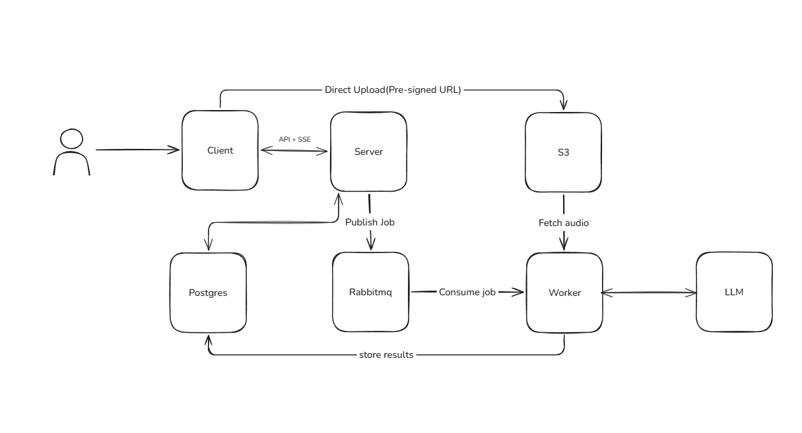
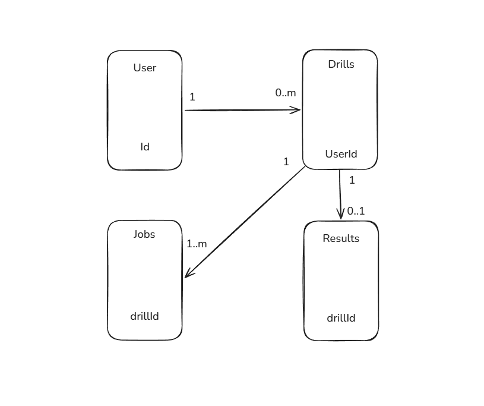

# Speako - AI-Powered Speaking Practice Platform

Speako is an AI-powered speaking practice platform that helps users improve their communication skills through structured speaking drills. Users select a drill, record a 30–90 second response, and receive feedback on pacing, fluency, vocabulary, and coherence. The platform processes audio asynchronously and provides a transcript with detected filler words, long pauses, and an overall speaking assessment.

---

## System Architecture

---

## Key Components

### Frontend — Speako Client
- Provides the interface for performing speaking drills and returning results to users.

### Backend — API Server
- Handles client requests and manages the application's business logic.

### Amazon S3 — Audio Storage
- Receives audio uploads directly from the client through pre-signed URLs.
- Keeps large audio files out of the main API and database, improving scalability.

### RabbitMQ — Job Queue
- Decouples the API server from the AI processing workers.
- Supports reliable background processing and workload distribution.

### Worker — Audio Processing Service
- Prepares audio and transcription data for analysis, using speech-to-text processing if required.
- Sends the relevant audio-derived content to the LLM for evaluation.

### PostgreSQL — Application Database
- Stores user information and drill metadata.
- Maintains relationships between users, drills, and processing jobs.

### Real-Time Communication — Server-Sent Events (SSE)
- Keeps the client informed while an audio-analysis job is being processed.
- Streams status changes such as queued, processing, completed, or failed.

---

## Database Design

## Technology Stack

| Component | Technology |
|---|---|
| Frontend | React / Next.js |
| Backend API | Node.js / Express |
| Audio storage | Amazon S3 |
| Database | PostgreSQL |
| Message broker | RabbitMQ |
| Background processing | Worker service |
| AI evaluation | LLM API |
| Real-time updates | Server-Sent Events (SSE) |

---